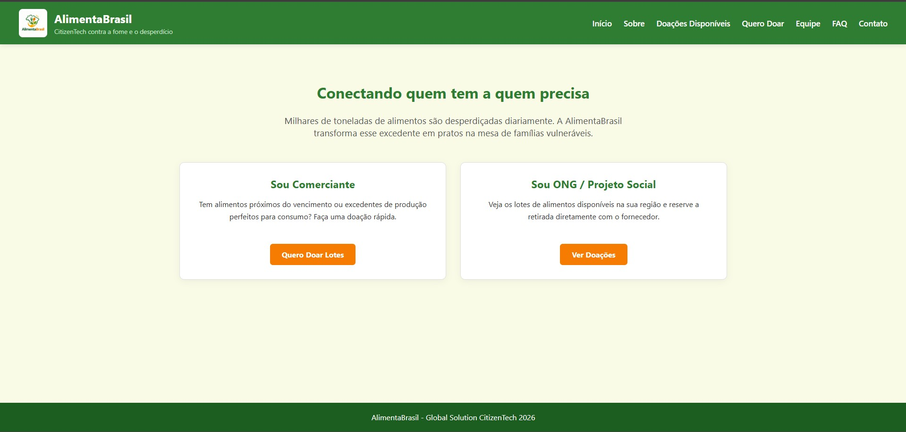

# AlimentaBrasil - CitizenTech Contra o Desperdício Alimentar 🍎

Plataforma digital CitizenTech que conecta supermercados, restaurantes e comerciantes com ONGs e famílias em situação de vulnerabilidade, facilitando a doação de alimentos próprios para consumo que seriam desperdiçados.

## 📌 Descrição da Solução (Global Solution 2026/2)
O projeto atua diretamente nos **ODS 2 (Fome Zero), 10, 11 e 13 da ONU**. A nossa interface Front-End visa entregar duas experiências principais:
1. **Quero Doar:** Formulário ágil para comerciantes publicarem lotes excedentes.
2. **Doações Disponíveis:** Painel para ONGs filtrarem as doações por tipo de alimento (perecíveis, secos, prontos) e prazo de validade.

## 🛠️ Tecnologias Utilizadas
* **HTML5:** Estrutura semântica e acessibilidade.
* **CSS3:** Estilização com design system responsivo (@media queries).
* **JavaScript:** Manipulação do DOM para o Menu Mobile, Validação de Formulários com prevenção de erros, e um Sistema de Filtro Duplo dinâmico.

## 👥 Autores & Créditos

| Foto | Nome | RM | Turma | Links |
| :--- | :--- | :--- | :--- | :--- |
|  | Murilo Ripani Barbeiro | 576374 | 1TDSPS-2026 | [LinkedIn](URL) • [GitHub](https://github.com/muriloripani) |
|  | João Augusto Moreira | 575087 | 1TDSPS-2026 | [LinkedIn](URL) • [GitHub](https://github.com/jaugustom0106-art) |
|  | Bernardo Borges Franco | 576078 | 1TDSPS-2026 | [LinkedIn](URL) • [GitHub](https://github.com/borgexss328) |
|  | Matheus Batista da Silva | 574575 | 1TDSPS-2026 | [LinkedIn](URL) • [GitHub](https://github.com/MatheusBatista1910) |
|  | Rafael de Oliveira Santos | 575758 | 1TDSPS-2026 | [LinkedIn](URL) • [GitHub](https://github.com/rafaosfiap) |

## Estrutura de Pastas

```text
alimenta-brasil/
├── css/
│   └── style.css
├── imagens/
│   └── foto-logo.jpg
├── js/
│   └── script.js
├── index.html
├── sobre.html
├── doacoes.html
├── quero-doar.html
├── integrantes.html
├── faq.html
├── contato.html
└── README.md
```

## Capturas de Tela do Sistema




*Legenda: Visão geral da interface responsiva e das funcionalidades da plataforma AlimentaBrasil.*

## Repositório

Repositório Oficial GitHub: https://github.com/muriloripani/alimentabrasil

## Contato

Para parcerias institucionais ou suporte: muribarbeiro@gmail.com

*Legenda: Visão geral da interface responsiva e das funcionalidades da plataforma AlimentaBrasil.*

🔗 Repositório
Repositório Oficial GitHub: https://github.com/muriloripani/alimentabrasil

✉️ Contato
Para parcerias institucionais ou suporte: muribarbeiro@gmail.com