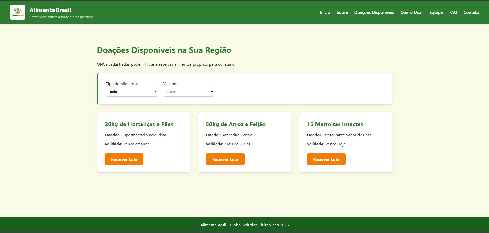
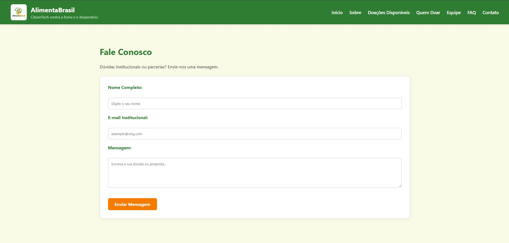

# AlimentaBrasil - CitizenTech Contra o Desperdício Alimentar 🍎

Plataforma digital CitizenTech que conecta supermercados, restaurantes e comerciantes com ONGs e famílias em situação de vulnerabilidade, facilitando a doação de alimentos próprios para consumo que seriam desperdiçados.

## 📌 Descrição da Solução (Global Solution 2026/2)
O projeto atua diretamente nos **ODS 2 (Fome Zero), 10, 11 e 13 da ONU**. A nossa interface Front-End visa entregar duas experiências principais:
1. **Quero Doar:** Formulário ágil para comerciantes publicarem lotes excedentes.
2. **Doações Disponíveis:** Painel para ONGs filtrarem as doações por tipo de alimento (perecíveis, secos, prontos) e prazo de validade.

## 🛠️ Tecnologias Utilizadas
* **HTML5:** Estrutura semântica e acessibilidade.
* **CSS3:** Estilização com design system responsivo (@media queries).
* **JavaScript:** Manipulação do DOM para o Menu Mobile, Validação de Formulários com prevenção de erros, e um Sistema de Filtro Duplo dinâmico.

## 👥 Autores & Créditos

Foto	Nome	RM	Turma	Links
	Murilo Ripani Barbeiro	576374	1TDSPS-2026	LinkedIn • GitHub
	João Augusto Moreira	575087	1TDSPS-2026	LinkedIn • GitHub
	Bernardo Borges Franco	576078	1TDSPS-2026	LinkedIn • GitHub
	Matheus Batista da Silva	574575	1TDSPS-2026	LinkedIn • GitHub
	Rafael de Oliveira Santos	575758	1TDSPS-2026	LinkedIn • GitHub

## 📁 Estrutura de Pastas
```text
alimenta-brasil/ 
├── css/ 
│   └── style.css            # Estilização responsiva
├── imagens/                 # Logotipos e assets
├── js/ 
│   └── script.js            # Lógica interativa da aplicação
├── index.html               # Página inicial 
├── sobre.html               # ODS e Propósito do projeto
├── doacoes.html             # [SOLUÇÃO] Lista de lotes com filtro dinâmico JS
├── quero-doar.html          # [SOLUÇÃO] Formulário de cadastro de lotes 
├── integrantes.html         # Equipe desenvolvedora
├── faq.html                 # Dúvidas Frequentes 
├── contato.html             # Formulário de contato institucional
└── README.md                # Documentação técnica

## 🖼️ Capturas de Tela do Sistema


<br><br>

<br><br>


*Legenda: Visão geral da interface responsiva e das funcionalidades da plataforma AlimentaBrasil.*

🔗 Repositório
Repositório Oficial GitHub: https://github.com/muriloripani/alimentabrasil

✉️ Contato
Para parcerias institucionais ou suporte: muribarbeiro@gmail.com